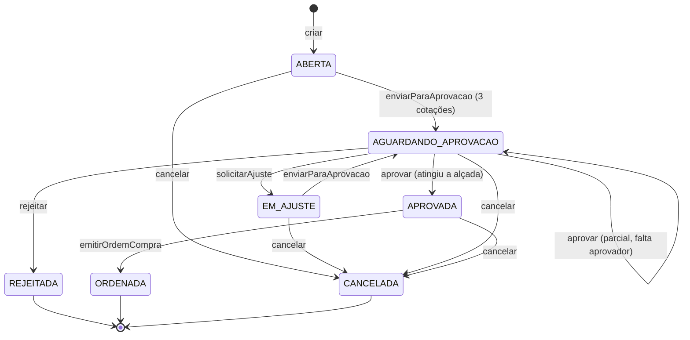
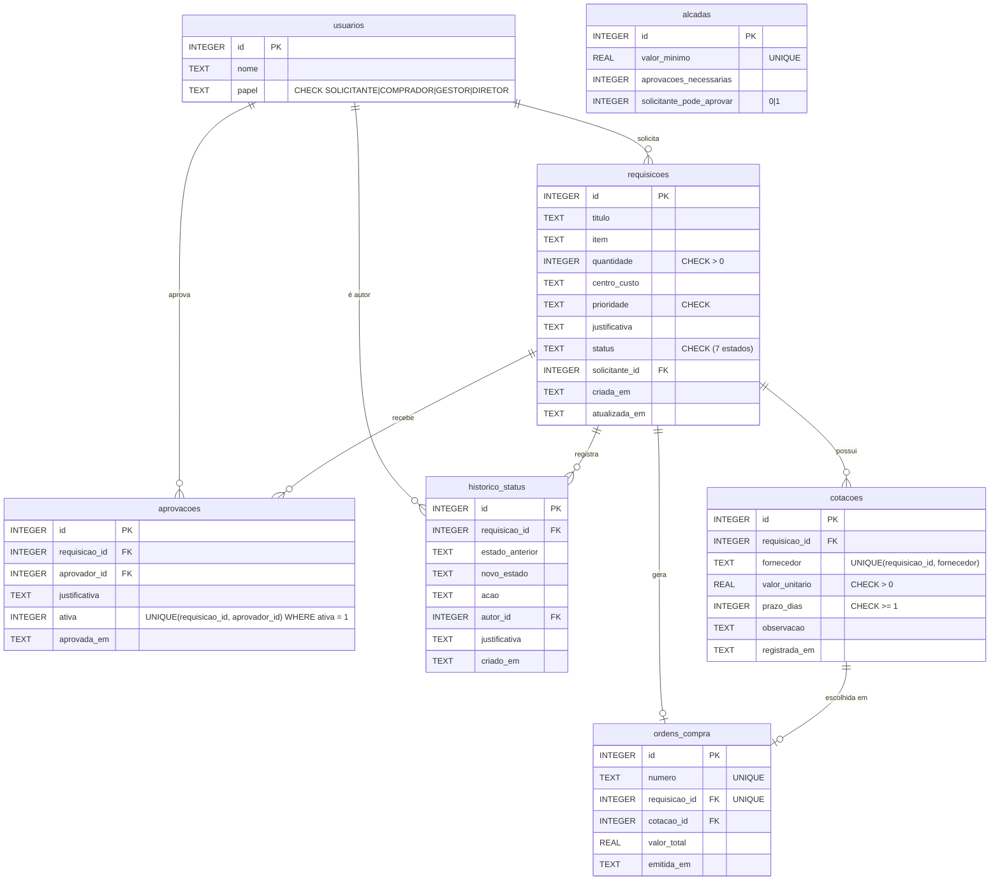

# Solicitação de Compras Corporativas (Procurement) — Trabalho 3

PPW2 · Projeto 11 · Leonardo de Chico

Evolução dos trabalhos 1 e 2: os arquivos JSON deram lugar a um **banco relacional (SQLite)** e o
status da requisição agora só muda por uma **máquina de estados**, com **RBAC**, **guardas de
transição**, **alçadas de aprovação configuráveis** e **trilha de auditoria** gravada na mesma
transação ACID.

- **Backend:** NestJS (camadas domain / application / infrastructure / presentation)
- **Frontend:** Next.js (React)
- **Banco:** SQLite pelo módulo nativo `node:sqlite` do Node (nenhuma instalação extra)

---

## Como rodar

> Requisito: **Node.js 22.13 ou superior** (testado no Node 24). O SQLite já vem dentro do Node.

### 1. Backend (porta 8000)

```bash
cd server
npm install
npm run start:dev
```

Na primeira subida é criado `server/data/procurement.db` a partir de `server/database/schema.sql`
(tabelas, constraints, triggers e dados iniciais). **Todas as queries aparecem no terminal com o prefixo `[SQL]`.**

Para apagar o banco e começar do zero: `npm run db:reset` (e suba o servidor de novo).

Teste de ponta a ponta da API (com o backend rodando, em outro terminal): `npm run test:api`
— 34 verificações de RBAC, guardas, alçadas, ajuste, cancelamento e códigos HTTP (cria dados de teste no banco).

### 2. Frontend (porta 3000)

```bash
cd web
npm install
npm run dev
```

Acesse **http://localhost:3000**. No topo há o seletor **Usuário** (login simulado): troque de usuário
para fazer cada papel do fluxo.

| id | Usuário | Papel |
| -- | ------- | ----- |
| 1 | Ana Souza | SOLICITANTE |
| 2 | Bruno Lima | COMPRADOR |
| 3 | Carla Mendes | GESTOR |
| 4 | Diego Rocha | GESTOR |
| 5 | Elisa Prado | DIRETOR |

---

## Regras de negócio

### Alçadas de aprovação (tabela `alcadas`)

O valor da compra é **melhor cotação × quantidade**. A alçada usada é a faixa de **maior
`valor_minimo` que seja ≤ valor**. Nenhum id de usuário fica fixo no código: as regras usam
**papéis** e a tabela de alçadas.

| Faixa | Aprovações | Solicitante pode aprovar a própria compra? |
| ----- | ---------- | ------------------------------------------ |
| a partir de R$ 0,00 | 1 | sim |
| a partir de R$ 1.000,00 | 1 | **não** (teto do solicitante) |
| a partir de R$ 5.000,01 | **2 gestores diferentes** | não |

Para mudar uma regra basta alterar a tabela (ex.: `UPDATE alcadas SET valor_minimo = 10000.01 WHERE id = 3;`)
ou o `INSERT` no fim do `schema.sql` + `npm run db:reset`.

### Matriz de transições (RBAC + guardas)

Arquivo: [`server/src/module/procurement/domain/maquina-estados/transicoes.ts`](server/src/module/procurement/domain/maquina-estados/transicoes.ts)

| Ação | De | Para | Papéis | Guardas / regras |
| ---- | -- | ---- | ------ | ---------------- |
| `editar` | ABERTA, EM_AJUSTE | (mantém) | SOLICITANTE, GESTOR, DIRETOR | só o dono da requisição |
| `registrarCotacao` | ABERTA, EM_AJUSTE | (mantém) | COMPRADOR | máx. 3 cotações; fornecedor único (UNIQUE no banco) |
| `removerCotacao` | ABERTA, EM_AJUSTE | (mantém) | COMPRADOR | — |
| `enviarParaAprovacao` | ABERTA, EM_AJUSTE | AGUARDANDO_APROVACAO | COMPRADOR | exige 3 cotações; exige alçada |
| `aprovar` | AGUARDANDO_APROVACAO | APROVADA **ou** continua aguardando | GESTOR, DIRETOR | teto do solicitante; aprovador diferente dos anteriores |
| `rejeitar` | AGUARDANDO_APROVACAO | REJEITADA | GESTOR, DIRETOR | justificativa obrigatória |
| `solicitarAjuste` | AGUARDANDO_APROVACAO | EM_AJUSTE | GESTOR, DIRETOR | justificativa; invalida as aprovações da rodada |
| `emitirOrdemCompra` | APROVADA | ORDENADA | COMPRADOR | usa a cotação de menor valor |
| `cancelar` | ABERTA, EM_AJUSTE, AGUARDANDO_APROVACAO, APROVADA | CANCELADA | SOLICITANTE (só a própria), GESTOR, DIRETOR | justificativa; invalida aprovações |

### Diagrama de estados



### Códigos HTTP

| Código | Quando |
| ------ | ------ |
| 400 | dado inválido (campo vazio, número ≤ 0, justificativa faltando) |
| 401 | cabeçalho `x-usuario-id` ausente ou usuário inexistente |
| 403 | papel sem permissão (RBAC) / teto do solicitante / não é o dono |
| 404 | requisição não encontrada |
| 409 | ação não permitida no status atual, fornecedor repetido, alteração concorrente |
| 422 | guarda de negócio bloqueou (faltam cotações, limite de cotações, aprovador repetido) |

---

## Modelo de dados (DER)



- **Normalização:** usuário, cotação, aprovação, ordem e histórico ficam em tabelas próprias ligadas
  por chave estrangeira (nada de listas dentro de uma coluna, como era no JSON). `alcadas` é tabela de
  configuração independente.
- **Integridade:** `PRAGMA foreign_keys = ON`, `CHECK` em status/papel/prioridade/valores, `UNIQUE`
  em fornecedor por requisição, número da OC e uma OC por requisição; índice único parcial impede o
  mesmo gestor aprovar duas vezes a mesma rodada.
- **Auditoria imutável:** triggers `historico_sem_update` e `historico_sem_delete` bloqueiam qualquer
  alteração no `historico_status`.

---

## Transação ACID de uma transição

Toda ação de fluxo roda em `FluxoAprovacaoService.executar()` dentro de `Banco.transacao()`:

```
BEGIN IMMEDIATE                       -- lock de escrita
SELECT ... FROM requisicoes JOIN usuarios ...      (lê requisição)
SELECT ... FROM cotacoes / aprovacoes / ordens_compra
SELECT ... FROM usuarios WHERE id = ?              (quem está agindo)
SELECT * FROM alcadas WHERE valor_minimo <= ? ORDER BY valor_minimo DESC LIMIT 1
   -> MaquinaEstados.transicionar() valida status, papel, justificativa e guardas
INSERT INTO aprovacoes / ordens_compra ...         (efeito da ação, se houver)
UPDATE requisicoes SET status = ? WHERE id = ? AND status = ?   (lock otimista)
INSERT INTO historico_status (...)                 (auditoria)
COMMIT                                -- ou ROLLBACK se qualquer passo falhar
```

---

## Endpoints

Todas as rotas que alteram dados exigem o cabeçalho `x-usuario-id`.

| Método | Rota | Ação |
| ------ | ---- | ---- |
| GET | `/procurement/usuarios` | lista usuários |
| GET | `/procurement/alcadas` | lista alçadas |
| GET | `/procurement/requisicoes` | lista requisições (1 query, sem N+1) |
| GET | `/procurement/requisicoes/:id` | detalhe + `acoesDisponiveis` + histórico |
| POST | `/procurement/requisicoes` | abre requisição |
| PUT | `/procurement/requisicoes/:id` | altera dados (ABERTA/EM_AJUSTE, só o dono) |
| POST | `/procurement/requisicoes/:id/cotacoes` | registra cotação |
| DELETE | `/procurement/requisicoes/:id/cotacoes/:cotacaoId` | remove cotação |
| POST | `/procurement/requisicoes/:id/enviar` | envia para aprovação |
| POST | `/procurement/requisicoes/:id/aprovar` | aprova (`{ justificativa? }`) |
| POST | `/procurement/requisicoes/:id/rejeitar` | rejeita (`{ justificativa }`) |
| POST | `/procurement/requisicoes/:id/solicitar-ajuste` | devolve para ajuste (`{ justificativa }`) |
| POST | `/procurement/requisicoes/:id/cancelar` | cancela (`{ justificativa }`) |
| POST | `/procurement/requisicoes/:id/ordem-compra` | emite a ordem de compra |

Não existe rota para "mudar o status" diretamente: o status só muda pelas ações acima.

---

## Estrutura de pastas

```
server/
├── database/schema.sql                 # tabelas, constraints, triggers e dados iniciais
└── src/
    ├── main.ts                         # sobe o Nest, CORS e filtro de erros
    ├── shared/
    │   ├── domain/erros.ts             # tipos de erro -> códigos HTTP
    │   ├── domain/value.objects/       # Dinheiro, Quantidade, Prioridade, Texto
    │   ├── infrastructure/database/banco.ts   # conexão SQLite, log [SQL], transação
    │   └── presentation/erro-http.filter.ts   # traduz erro -> HTTP
    └── module/procurement/
        ├── domain/
        │   ├── entity/requisicao.ts            # tipos, valor total, validações
        │   ├── maquina-estados/transicoes.ts   # MATRIZ estado x ação x papel x guardas
        │   ├── maquina-estados/guardas.ts      # uma classe por regra
        │   ├── maquina-estados/maquina-estados.ts
        │   └── ports/requisicao.repository.ts  # interface do repositório
        ├── application/
        │   ├── requisicao.service.ts           # cadastro e consultas
        │   └── fluxo-aprovacao.service.ts      # transições de status + auditoria
        ├── infrastructure/requisicao.sqlite.repository.ts   # SQL
        └── presentation/requisicao.controller.ts            # rotas REST
web/src/
├── app/                # páginas: lista, nova, detalhe, editar + seletor de usuário
└── lib/                # tipos e chamadas à API
```

## SOLID aplicado

- **SRP:** a máquina só decide (não grava); o repositório só faz SQL; o service orquestra; cada guarda verifica uma regra.
- **OCP:** nova regra = nova classe `Guarda` adicionada na lista da transição; novo passo do fluxo = nova linha em `TRANSICOES`. A classe `MaquinaEstados` não muda.
- **LSP:** a máquina chama `guarda.verificar(ctx)` em qualquer guarda sem saber qual é; todas são substituíveis pela interface `Guarda`.
- **DIP:** services dependem da interface `RequisicaoRepository`, não do SQLite.

## Documentos

- [`AI-LOG.md`](AI-LOG.md) — registro de prompts, respostas e refatorações
- [`docs/ai-decisions.md`](docs/ai-decisions.md) — decisões de modelagem consultadas na IA e a crítica
- [`docs/defesa-oral.md`](docs/defesa-oral.md) — roteiro para a arguição (fluxo, queries e modificações ao vivo)
